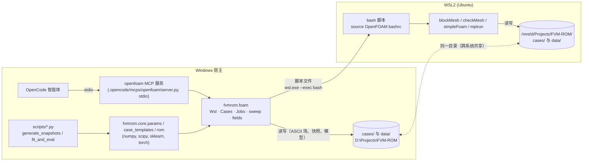
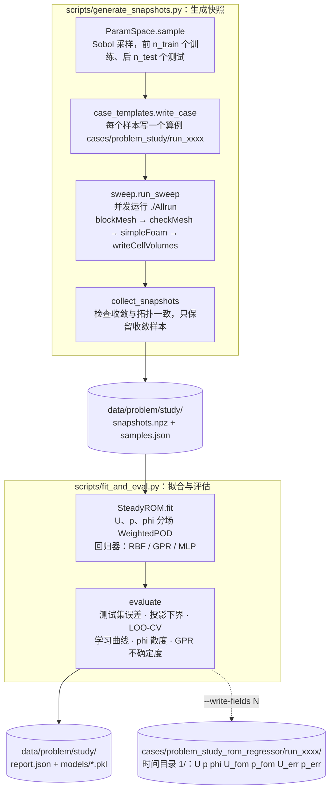

# 架构

两个入口并列，都依赖共享的 `fvmrom.foam`：`.opencode/mcps/openfoam/server.py` 提供的 MCP 服务面向智能体的
交互调试；ROM 脚本和库（采样、POD、回归、评估）直接导入 `fvmrom.foam`，**不经过 MCP 进程**。`fvmrom.foam`
通过脚本文件驱动 WSL 里的 OpenFOAM，并在 Windows 侧直接读写 `cases/` 与 `data/`（WSL 中对应
`/mnt/d/Projects/FVM-ROM/...`）。`fvmrom.foam` 各模块的作用与调用关系见 `docs/foam.md`。

## 设计决策

- **MCP 服务运行在 Windows 侧。** 数值 ROM 技术栈统一在一个 Python 环境（uv）中；WSL 仅作为
  OpenFOAM 的执行后端。
- **用脚本文件，不用命令行。** 每次调用都会在 `.fvmrom/scripts/` 下写一个 LF 换行的脚本，再执行
  `wsl.exe --exec bash <script>`，避免 PowerShell/cmd/bash 的引号问题。
- **只运行 OpenFOAM 可执行文件。** `type -P` 的解析结果必须位于 `$WM_PROJECT_DIR`、
  `$FOAM_USER_APPBIN` 或 `$FOAM_SITE_APPBIN` 之下（或是算例内的脚本，如 `./Allrun`）。
  文件访问被限制在 `cases/<case>/` 内（`safe_join`）。
- **后台任务基于文件**（`.fvmrom/jobs/<id>/{meta.json,pid,exit_code}`），并运行在独立会话
  （`setsid`）中，因此 MCP 重启后，状态查询和 `stop_job` 依然有效。任务运行期间会保持 `wsl.exe`
  句柄打开，避免 WSL 认为发行版处于空闲状态。
- **算例放在 `/mnt/d`。** 简单，且两侧都可见。通过 9P 桥的文件 I/O 比 ext4 慢；如果写快照成为瓶颈，
  可将 `FVMROM_CASES_DIR` 指向 Windows 可访问的 `\\wsl.localhost\...` 路径，或把重计算挪到 WSL 文件系统。
- **MCP 服务是 harness 接入层的独立脚本。** 服务脚本放在 `.opencode/mcps/<功能>/server.py`（当前
  `openfoam`），用绝对导入（`from fvmrom.foam import ...`）调用库；`src/fvmrom/` 只保留 ROM 代码与
  OpenFOAM 访问层，不承担 OpenCode 服务注册。服务名与目录名一致（`<功能>`），也没有 `<功能>-mcp` 命令。
- **基础模块集中在 `fvmrom/core/`，且刻意不重导出。** `core.config`（`Settings`、`PROJECT_ROOT`）只依赖
  标准库，供 `fvmrom.foam` 使用；`core.params`（`ParamSpace`）依赖 scipy，由 `case_templates` 与 `rom`
  共用。`core/__init__.py` 留空：若在其中重导出 `params`，只装基础依赖的 `foam` 与 MCP 服务也会被迫导入
  scipy。依赖方向：`core.config` ← `foam` ← `case_templates`、`rom`；`core.params` ← `case_templates`、`rom`。
- **ROM 功能先做在 Python 库里，不动 MCP。** 批量采样、场读取、POD、回归、误差评估都由 `fvmrom`
  直接提供（`uv run ...` 即可使用）；MCP 服务保持为交互调试接口，确实需要时再把常用流程封装成工具。
- **场 I/O 只支持 ASCII。** `fvmrom.foam.fields` 只处理 ASCII 文本场，二进制/压缩文件直接给出明确错误；
  因此算例统一用 `writeFormat ascii`、`writePrecision 12`（同时 `purgeWrite 1` 只保留最新时间）。
- **数据目录与算例目录解耦。** `Settings.data_dir`（`FVMROM_DATA_DIR`，默认 `<项目>/data`）独立于
  `cases_dir`：算例随时清理重跑，快照与模型仍可保留。
- **`numpy` 放在基础依赖里**，因为 `fvmrom.foam.fields` 需要它，不应等到 `--extra rom` 才可用。
- **大文件不入库。** `.gitignore` 整体忽略 `cases/*` 与 `data/*`，仅保留目录下的 `.gitkeep`。

## ROM 实现现状

技术路线已确定：加权 POD（`WeightedPOD`）+ 参数到模态系数的回归（RBF / GPR / MLP）构成稳态 ROM。
阶段 1 的实现全部在 `src/fvmrom/` 内，不依赖 MCP。

### 模块分工

- `fvmrom.core.params`：`ParamSpace` 描述参数（名称、上下界、对数标志），提供 `to_unit`/`from_unit`
  归一化与 Sobol / LHS 采样；Sobol 前缀嵌套（增量扩样时旧样本仍是新样本的子集），对数参数要求 > 0。
- `fvmrom.core.config`：`Settings.data_dir`（`FVMROM_DATA_DIR`，默认 `<项目>/data`）与 `cases_dir` 解耦。
- `fvmrom.foam.fields`：ASCII 场读写（`read_field`/`write_field`，`FoamField` 含 `dimensions`）、
  `latest_time`、网格拓扑 `read_topology`（owner/neighbour/boundary），以及 `phi_vector`/`phi_divergence`。
  计算 phi 散度时按 patch 的 `type == "empty"` 跳过（2D 算例的空方向），非 empty 却无数值的 patch 直接报错。
- `fvmrom.foam.sweep`：参数扫描与快照收集。
  - `run_sweep`：并发执行各算例的 `./Allrun`，通过 `Jobs.status` 轮询进度，用 `parse_log` 判定收敛
    并要求 `V` 场存在；支持 `resume`；`cases`/`jobs` 可注入便于测试；重写已有算例前先逐段校验路径一致，
    并调用 `Jobs.stop_case` 停掉残留任务；`finally` 中停止本次启动的任务，停止失败抛 `RuntimeError`
    并列出 job id（`stop` 因尚无 pid 失败时先 `wait_pid` 不超过 $20$ s 再重试）。
  - `collect_snapshots`：写出 `snapshots.npz` 与 `samples.json`，逐一比较各样本的 owner/neighbour/patches
    以确保拓扑一致；`n_faces` 取 phi 向量长度；为每个算例写 `<算例名>.foam` 便于 ParaView 打开。
    cylinder 的阻力系数 `cd` 取 `postProcessing/forceCoeffs` 下数值最大时间目录的 `coefficient.dat`
    最后一行第 2 列。
  - `validate_study`：校验算例命名规则、保留名与大小写冲突。
- `fvmrom.foam.jobs`：新增 `Jobs.wait_pid` 与 `Jobs.stop_case`——终止属于该算例的运行中/启动中任务的进程组
  （含 WSL 里的 simpleFoam/MPI 子进程），轮询到全部退出，超时抛错。
- `fvmrom.foam.logs`：FPE 判定改为行首匹配 `^Floating point exception`，避免把启动 banner
  `trapFpe: Floating point exception trapping enabled` 误判为崩溃。
- `fvmrom.case_templates`（算例模板）：`Problem` 协议（`name`、`space`、`fields`、`write_case`）与 `get_problem`，内置两个：
  - `cavity`：64×64×1， $\nu = 1/\mathrm{Re}$ ，`pRefCell 0`，SIMPLEC（`consistent yes`）。
  - `cylinder`： $D = 1$ ，12 块 O 型网格、32768 单元，域 $x \in [-10, 25]$ 、 $y \in [-10, 10]$ ；inlet 固定速度、outlet 固定压力、
    上下 `slip`、圆柱 `noSlip`，并输出 `forceCoeffs`。
  两者都按 ESI v2312 的写法：湍流在 `constant/turbulenceProperties`（`simulationType laminar`）、
  物性在 `constant/transportProperties`；`Allrun` 依次执行 `blockMesh`、`checkMesh`（日志含 `Failed` 则失败）、
  `simpleFoam`、`postProcess -func writeCellVolumes -latestTime`。
- `fvmrom.rom`：
  - `WeightedPOD`：加权内积下做瘦 SVD，按 `energy_tol` 或 `n_modes` 截断，`project`/`reconstruct` 完成
    系数与场的互转。内积权重、公式与截断规则见 `docs/pod.md`。
  - `regressors`：`RBFRegressor` / `GPRRegressor` / `MLPRegressor` 三项，统一接口
    `fit(Z, A)` / `predict(Z, return_std=False)`，`make_regressor` 按名构造（`REGRESSOR_KINDS`）。
    算法、超参与 `.pkl` 存储格式见 `docs/regressors.md`。
  - `SteadyROM`：U、p 用体积权重，phi 用单位权重；`fit`/`predict`/`save`/`load`；`save` 记录依赖版本，
    `load` 发现版本不一致发 `RuntimeWarning`（pickle 只应加载本地可信文件）。
  - `evaluate`：`rel_l2_error`、`projection_error`、`retained_energy`、`loo_cv`（每折重做 POD 与回归）、
    `evaluate_on_test`（含 phi 散度）、`learning_curve`（嵌套 Sobol 前缀、固定测试集，MLP 单种子 0）、
    `std_error_correlation`（GPR 标准差与误差的 Spearman 相关）。

### 数据流

`--write-fields` 把 ROM 预测写成 `cases/<problem>_<study>_rom_<regressor>/run_xxxx/`（时间目录 `1/` 含
`U p phi U_fom p_fom U_err p_err`）。

### 质量守恒

phi 的均值与模态都是（离散无散度）快照的线性组合，因此重建 phi 的散度残差也是快照残差的线性组合。
这只保证 phi 在离散意义下无散度，不保证与重建的 U 通量一致。
