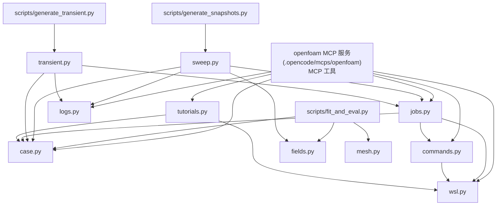

# OpenFOAM 访问层（`fvmrom.foam`）

`src/fvmrom/foam/` 把"在 WSL2 里运行 OpenFOAM、读写算例文件"包装成 Python 接口。上层代码不直接拼
`wsl.exe` 命令，也不用自己管路径映射；换机器、换发行版时只改 `fvmrom.core.config`。

- **使用者有两类。** MCP 服务（脚本 `.opencode/mcps/openfoam/server.py`）只用通信与算例管理部分：`wsl`、
  `commands`、`jobs`、`logs`、`case`、`tutorials`。ROM 代码与脚本直接用这套基础模块，另外使用 `fields`、
  `mesh`、`sweep`、`transient` 这几个 ROM 专用模块——它们**不经过 MCP**，MCP 的服务代码也不使用它们。
- **执行与读写分开。** OpenFOAM 计算只在 WSL2 内进行；场、网格、日志、`forceCoeffs` 等文件全部在 Windows
  侧直接读 `cases/`，不为读一个文件起一次 WSL 进程。
- 整体位置与设计决策见 `docs/architecture.md`。

| 模块 | 作用 | 使用者 |
| --- | --- | --- |
| `wsl.py` | Windows ↔ WSL 通信、路径映射、生成执行脚本 | MCP、ROM |
| `commands.py` | 为单个应用生成"source 环境 → 校验 → 运行"的脚本 | MCP（`run_foam_app`）、`Jobs` |
| `jobs.py` | 后台作业：启动 / 状态 / 停止 | MCP、`sweep`、`transient` |
| `logs.py` | 日志尾部读取、残差与终止状态解析 | MCP、`sweep`、`transient` |
| `case.py` | `cases/` 目录：列举、读取、写入、摘要 | MCP、ROM |
| `tutorials.py` | 列出 / 复制 `$FOAM_TUTORIALS` 中的教程算例 | MCP（`list_tutorials`、`copy_tutorial`） |
| `fields.py` | ASCII 场读写、网格拓扑、`phi` 向量化与散度 | ROM |
| `mesh.py` | 面 / 单元几何量、`linear` 插值权重、`phi` 权重 | ROM |
| `sweep.py` | 阶段 1 的参数扫描与快照收集 | `scripts/generate_snapshots.py` |
| `transient.py` | 阶段 2 的单轨迹瞬态运行与受力系数读取 | `scripts/generate_transient.py` |

## 与 WSL / OpenFOAM 通信

### `wsl.py`

- 提供 `win_to_wsl` / `wsl_to_win` 双向路径映射（`D:\...` ↔ `/mnt/d/...`），只接受盘符路径，因为 WSL 只有
  通过 `/mnt/<盘符>` 才能看到 Windows 文件。
- **命令从不经 `wsl.exe` 命令行传递。** 每次调用把 bash 内容写成 LF 换行的脚本（放在 `.fvmrom/scripts/`），
  再执行 `wsl.exe --exec bash /mnt/d/.../<script>`。命令行里永远只有脚本路径，引号、重定向、`&&` 全部留在
  脚本文件里，绕开 PowerShell / cmd / bash 三层转义与 CRLF 问题。
- `run` 是前台短命令：外面套 `timeout -k 5`，捕获 stdout / stderr 并归一化为 `\n`，跑完删除临时脚本；查
  `pid` 这类不需要 OpenFOAM 环境的命令可以关闭 `source`，省一次启动开销。
- `spawn` 用 `setsid -w` 起独立会话，把 `Popen` 句柄交给调用方：只要句柄打开，WSL 就不会认为发行版空闲而
  停掉后台算例。作业状态本身存在文件里，句柄丢了也不影响查询。

### `commands.py`

- 只回答一个问题："这个应用在这个算例里怎么跑"。生成的脚本依次是：可选的 `trap` 写退出码、写 `pid`、
  `cd <case>`、`exec > log.<app> 2>&1`、校验应用、运行；`np > 1` 时改用
  `mpirun -np N ... -parallel`。
- 应用名校验有两层：Python 侧正则只允许裸名字或 `./脚本`（拒绝 `..` 与路径分隔符）；bash 侧再用 `type -P`
  解析，要求结果落在 `$WM_PROJECT_DIR`、`$FOAM_USER_APPBIN`、`$FOAM_SITE_APPBIN` 之下，或者就是算例内的
  `./Allrun`。这样智能体给的字符串不会被当成任意可执行文件或任意路径执行。
- 日志名不许含路径分隔符、不许以 `.` 开头，因此输出只能落在算例目录内；默认 `log.<app>`，与 AGENTS.md 的
  约定一致。

### `jobs.py`

- 所有长任务都是后台作业：`Jobs.start` 建 `.fvmrom/jobs/<job_id>/`，写 `meta.json`，由 `Wsl.spawn` 启动
  生成的脚本；日志仍写在算例里，状态文件与算例解耦。
- 状态以文件为准：`exit_code` 文件表示结束（`completed` / `failed`），否则看内存里的 `Popen` 或 WSL 内
  `kill -0 <pid>` 判断 `running`；没有退出码、也没有存活进程就是 `died`（被外部杀掉或 WSL 重启）。因此
  MCP 重启后 `job_status` 依然有效，这是"状态落盘而非只放内存"的直接理由。
- `stop` 向进程组发 TERM（`kill -TERM -- -pid`），能一并带走 `mpirun` 与求解器子进程；`wait_pid` 处理"作业
  还在 `starting`、`pid` 文件尚未写出"时无法停止的竞态；`stop_case` 组合这两者，用于**清理算例前先停干净**
  ——否则残留进程会在目录删除后继续往原路径写文件。

### `logs.py`

- 只有两个功能：`tail`（读文件末尾 64 KB，取最后 n 行，日志可能很大）与 `parse_log`（正则抽取每个场的
  initial / final residual 与迭代数、最后一个 `Time =`、`solution converged`、`End`、`FOAM FATAL`、浮点
  异常）。
- 易踩的坑：启动 banner 里有 `trapFpe: Floating point exception trapping enabled`，所以浮点异常只在**行首**
  匹配 `^Floating point exception`（被 shell 报告的那种），否则每次正常运行都会被判成崩溃。

## 算例目录管理

### `case.py`

- `Cases` 是 `cases/` 的唯一入口，所有相对路径都过 `safe_join`：拒绝绝对路径、盘符和 `..` 越界，保证读写不
  会跑出 `cases/`。
- `read` 有 `MAX_READ_BYTES`（200 000 字节）上限并返回 `truncated`，`list_files` 有条目上限：这些结果会进入
  智能体的上下文，不能一次把整个 32k 单元的场文件或上千个文件塞进去。
- `summary` 一次给出判断算例状态需要的全部信息（是否有网格、时间目录、分解出的 `processor*` 数、
  `controlDict` 关键项、日志列表），MCP 的 `case_summary` 直接复用。
- 这里不做任何数值解析：`control_dict` 只按白名单取键，场内容交给 `fields`。

### `tutorials.py`

- 在 `$FOAM_TUTORIALS` 里按 `*/system/controlDict` 找算例，用 `cp -r` 复制到 `cases/`。
- 仅服务于 `list_tutorials` / `copy_tutorial` 两个 MCP 工具，用于交互调试；ROM 流程用的是
  `case_templates/`（算例模板）生成的算例，不依赖教程。

## 读写 OpenFOAM 文件

### `fields.py`

- 只在 Windows 侧读文件，**只支持 ASCII**：遇到 `format binary` 或 `.gz` 直接报错，而不是静默出错。这是算例统一
  `writeFormat ascii` 的原因。
- 自带一个很小的字典解析器：支持嵌套字典、`uniform` 与 `nonuniform List<...>`，遇到 `#include` 等预处理指令
  明确报错——宁可报"不支持"，也不假装能处理。
- `read_topology` 从 `polyMesh/{owner,neighbour,boundary}` 取面到单元的关系与 patch 区间，并用 owner 头部注释
  里的 `nCells` 做交叉校验；注释缺失时才退回 `max(owner) + 1`。
- `phi_vector` 把 `phi` 拼成"内部面 + 非 empty patch"的一维向量，patch 顺序与 `boundary` 文件一致，`empty`
  （2D 算例的空方向）patch 跳过；`phi_divergence` 用同一布局按 owner 加、neighbour 减累加，得到每单元净外流
  通量——质量守恒指标就建立在这上面。
- `write_field` 可传 `template`：从 FOM 场继承 patch 的 `type`（`empty`、`wall` 等）与 `class`，只替换数值
  （`dimensions` 由调用方照模板给出）。ROM 写回时间目录时靠它保证新文件与 FOM 文件结构一致，否则 ParaView
  打不开或边界类型丢失。

### `mesh.py`

- 补上 `fields` 不提供的几何量：面心、面积矢量（指向 owner 外侧）、单元中心、单元体积，以及内部面的
  `linear` 插值权重 $f = w\,P + (1 - w)\,N$ 。
- 公式照 OpenFOAM `primitiveMeshTools` 的做法：面用围绕顶点均值的中心三角扇，单元用围绕平均面心的棱锥分解。
  目标是和 OpenFOAM 写出的 `V` 场在舍入误差内一致，避免几何量本身成为误差来源。
- `phi_weights` 给出 `phi` 的近似单元体积 $L^2$ 范数权重：内部面取 $(V_P + V_N)/(2\|\mathbf{S}_f\|^2)$ ，patch 面取
  $V_P/\|\mathbf{S}_f\|^2$ （ $V_P$ 、 $V_N$ 是两侧单元体积， $\mathbf{S}_f$ 是面面积矢量）。用途两个：给 `phi` 的
  POD 加权（`fit_and_eval.py --phi-weights area`），以及 U–phi 通量一致性评估的范数。
- 只读几何，**不画网格、不生成网格**；网格由 `case_templates/` 里的 `blockMeshDict` 模板生成。

## 批量与瞬态运行

### `sweep.py`

- 阶段 1 的调度器：一个参数样本一个算例 `cases/<problem>_<study>/run_xxxx`，最多 `max_parallel` 个后台作业
  同时跑，主循环轮询 `Jobs.status`，结束后用 `parse_log` 判定收敛并要求最新时间目录里有 `V`。
- 收敛判定不只看退出码：作业 `completed` 但日志未收敛算失败；日志收敛但缺 `V`（`postProcess` 没跑）也算
  失败。失败原因写进 `RunResult.message`。
- 重跑前先 `jobs.stop_case` 再删目录：WSL 里残留的 `simpleFoam` 会在目录删除后继续写原路径，留下半新半旧的
  文件。`finally` 中停掉本次启动的所有作业，停不掉就抛 `RuntimeError` 并列出 job id，不静默吞掉。
- 名字先校验再落地：`validate_study` 拒非法名、Windows 保留名、仅大小写不同的冲突；`_check_case_path` 拒
  `cavity_re1d.` 这类会被 Windows 归一化到别的目录的名字。
- `collect_snapshots` 只保留收敛样本，读 `U p phi`，以第一个样本的拓扑为基准逐样本比较 owner / neighbour /
  patches，不一致直接报错而不是悄悄算错；输出 `snapshots.npz` 与 `samples.json`（后者记录参数、角色、
  job id、失败原因，cylinder 另记 `cd`）。

### `transient.py`

- 阶段 2 的单轨迹运行：一次只跑一个瞬态算例 `cases/cylinder_transient_<study>/run_0000`，与 `sweep` 共用
  `Cases` / `Jobs` / `validate_study`。
- 两段式：spin-up 段只保留最后一个时刻，生产段从 `latestTime` 继续并按 `snapshot_dt` 写快照；两段输出追加到
  同一个 `log.pimpleFoam`，`run_transient` 以日志里 `End` 出现的次数等于阶段数判断完成。
- 瞬态通常要重启，OpenFOAM 每次都会在 `postProcessing/forceCoeffs/` 下新建一个以起始时间命名的目录；所以
  `read_forces` 把各目录的 `coefficient.dat` 合起来按时间排序，重复时间保留后一个目录的值，得到连续的
  Cd / Cl 序列。
- `courant_max` 取日志里 `Courant Number ... max:` 的最大值，给时间步长是否合理一个直接判据。
- 字段快照的收集尚未实现：`generate_transient.py` 目前只写 `forces.npz` 与 `meta.json`，快照收集留待阶段 2
  计划的 M1。

## 调用关系

上层只依赖"调度（`sweep` / `transient`）→ 基础（`case` / `jobs` / `logs` / `commands`）→ `wsl`"这条链；
`fields` / `mesh` 只被 ROM 一侧使用，MCP 完全不碰。

## 贯穿的设计原则

- **不通过命令行拼复杂引号。** 一切 shell 内容都写进脚本文件，命令行只剩 `wsl.exe --exec bash <脚本>`。
- **长任务一律走后台作业。** 调度器只轮询状态文件，MCP 调用不会被求解器阻塞，重启 MCP 也不丢任务。
- **名字与路径先校验。** 应用名、日志名、study 名、算例名都在写出前检查，防止越出 `cases/` 或撞上 Windows
  保留名、大小写规则。
- **读文件在 Windows 侧直接做。** 只有"运行 OpenFOAM"才进 WSL，省掉一次 WSL 启动和 `/mnt/d` 往返。
- **拓扑统一由 Python 生成的 `blockMeshDict` 保证。** 网格模板在 `case_templates/`，所有快照共用同一网格；
  `collect_snapshots` 仍然逐样本校验拓扑，防止有人绕过模板直接改算例。
- **只支持 ASCII。** 二进制 / 压缩的场与网格都会被明确拒绝，以便错误尽早暴露，而不是在解析时产生错位数。
