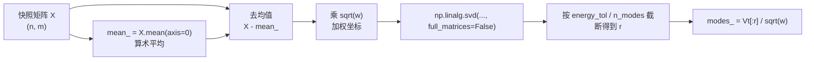

# 加权 POD

`fvmrom.rom.pod.WeightedPOD` 负责 ROM 的基提取：把快照矩阵 `X`（每行一个快照，形状 `(n, m)`）
降到少数几个模态上（阶段 1 稳态与阶段 2 瞬态共用）。加权内积让"物理上的场能量"（例如单元体积）而不是
网格点数决定模态的重要性。

- 代码：`src/fvmrom/rom/pod.py`
- 按场选择权重的规则：`src/fvmrom/rom/steady.py` 的 `_weights_for`
- 在 ROM 中的位置见 `docs/architecture.md`；系数到场的回归见 `docs/regressors.md`；瞬态侧如何使用 POD 见
  [docs/transient.md](transient.md)

## 加权内积

对长度为 $m$ 的场向量 $\mathbf{a}$, $\mathbf{b}$ 与逐分量权重 $w_i > 0$ ：

$$
\langle \mathbf{a}, \mathbf{b} \rangle_W = \sum_{i=1}^{m} w_i a_i b_i,
\qquad
\lVert \mathbf{a} \rVert_W = \sqrt{\langle \mathbf{a}, \mathbf{a} \rangle_W}
$$

$a_i$, $b_i$ 是展平后场向量的第 $i$ 个分量, $w_i$ 是对应的权重（代码里是 `weights`）。

- `weights=None` 表示单位权重。
- 非 `None` 时，权重必须与展平后的场长度一致、且全部为正的有限值，否则 `ValueError`。
- 单元中心场 `U`、`p` 用单元体积作权重（`steady.py` 的 `VOLUME_WEIGHTED = frozenset({"U", "p"})`）：
  - `p` 的展平长度等于 `n_cells`，权重直接用 `volumes`；
  - `U` 以 `(n_cells, 3)` 存储，展平后长度为 $3 \times$ `n_cells`，权重按 `np.repeat(volumes, 3)` 逐分量重复；
  - 其它长度组合直接抛 `ValueError`。
- 面通量 `phi` 默认用单位权重；传入 `phi_weights` 时改用面积权重，见下。
- 不在 `VOLUME_WEIGHTED` 中的场一律用单位权重。

### `phi` 的面积权重

把面通量 $\phi_f = \mathbf{u}_f \cdot \mathbf{S}_f$ 看作面法向速度，用近似体积加权的 $L^2$ 范数：

$$
w_f = \begin{cases}
\dfrac{V_P + V_N}{2 \lVert \mathbf{S}_f \rVert^2}, & \text{内部面} \\
\dfrac{V_P}{\lVert \mathbf{S}_f \rVert^2}, & \text{边界面（非 empty）}
\end{cases}
$$

其中 $V_P$ 、 $V_N$ 是 owner / neighbour 单元的体积， $\mathbf{S}_f$ 是面面积矢量；
`fvmrom.foam.mesh.phi_weights` 按 `phi_vector` 的布局给出这些权重。均匀网格上所有 $w_f$ 相同，等价于
单位权重（差一个常数因子）；非均匀网格上不再让小面主导 POD。

- 阶段 1 默认仍用单位权重；`scripts/fit_and_eval.py --phi-weights area` 可选用面积权重。
- 阶段 2 的瞬态 ROM 默认使用面积权重（见 [docs/transient.md](transient.md)）。
- 阶段 1 实测：cavity 为均匀网格，两种权重结果相同；cylinder 上面积权重使 `phi` 误差降低约 3–4%，
  FOM 的 U–`phi` 一致性指标从 1.17e-4 变为 1.02e-4（指标值随权重变化，不是 FOM 变准）。

## 拟合

`WeightedPOD(weights=None, n_modes=None, energy_tol=1e-10)`，调用 `fit(X)`：

公式（快照矩阵 $\mathbf{X} \in \mathbb{R}^{n \times m}$ ，权重向量 $\mathbf{w}$ ）：

$$
\bar{\mathbf{x}} = \frac{1}{n} \sum_{i=1}^{n} \mathbf{x}_i, \qquad
\mathbf{X}_c = \mathbf{X} - \mathbf{1}\bar{\mathbf{x}}^{\mathsf{T}}
$$

$$
\left(\mathbf{X}_c \sqrt{\mathbf{W}}\right)_{ij} = (\mathbf{X}_c)_{ij} \sqrt{w_j},
\qquad
\mathbf{X}_c \sqrt{\mathbf{W}} = \mathbf{U} \mathbf{S} \mathbf{V}^{\mathsf{T}} \ (\text{瘦 SVD})
$$

$$
\Phi_{kj} = \frac{\left(\mathbf{V}^{\mathsf{T}}\right)_{kj}}{\sqrt{w_j}} \quad (k = 1, \dots, r),
\qquad
\langle \mathbf{\phi}_k, \mathbf{\phi}_l \rangle_W = \delta_{kl}
$$

- 符号对应： $\bar{\mathbf{x}}$ = `mean_`（算术平均，不是体积加权平均）， $\mathbf{1}$ 是全 1 列向量，
  $\mathbf{X}_c$ = 去均值后的快照， $\mathbf{S}$ = `S`， $\mathbf{V}^{\mathsf{T}}$ = `Vt`， $\Phi$ = `modes_`
  （第 $k$ 行是模态 $\mathbf{\phi}_k$ ，即 $\mathbf{V}^{\mathsf{T}}$ 的前 $r$ 行），
  `singular_values_` = 前 $r$ 个奇异值 $s_1, \dots, s_r$ 。
- `Xc * sqrt(w)` 是逐列乘 $\sqrt{w_j}$ （一维数组按列广播）；除以 $\sqrt{w_j}$ 换回原坐标后，模态在加权内积下
  仍是标准正交的。

### 截断

先在加权坐标里按能量截断，再用数值秩兜底，最后应用 `n_modes` 上限。累计能量与保留的模态数为

$$
E_j = \frac{\sum_{i=1}^{j} s_i^2}{\sum_{i} s_i^2}, \qquad
r_{\text{energy}} = \min\left\{ j : E_j \ge 1 - \varepsilon \right\}
$$

$$
r_{\text{rank}} = \left| \left\{ i : s_i > 10^{-14} s_1 \right\} \right|, \qquad
r = \min\left( r_{\text{energy}},\ r_{\text{rank}},\ n_{\text{modes}} \right)
$$

其中 $\varepsilon$ = `energy_tol`， $n_{\text{modes}}$ = `n_modes`（`None` 时这一项不参与取小）。对应的代码在
`pod.py` 的 `_rank`：`np.cumsum(s**2) / np.sum(s**2)`、`np.searchsorted(energy, 1 - energy_tol, side="left") + 1`、
`np.count_nonzero(s > s[0] * 1e-14)`。`side="left"` 取第一个满足 $E_j \ge 1-\varepsilon$ 的下标（0 起），
加 1 后即保留的模态数。

- `energy_tol` 默认 `1e-10`，允许范围 `[0, 1)`；`n_modes` 必须非负（可以为 0）。
- `S` 为空、或 `S[0] <= 0` 时 `r = 0`，即没有可用模态。

## 投影与重建

`project(X)` 给出系数 $\mathbf{A}$ （形状 $(n, r)$ ），`reconstruct(A)` 换回场：

$$
A_{ik} = \sum_{j=1}^{m} w_j \left(X_{ij} - \bar{x}_j\right) \Phi_{kj},
\qquad
\mathbf{A} = (\mathbf{X} - \mathbf{1}\bar{\mathbf{x}}^{\mathsf{T}})\, \mathbf{W}\, \mathbf{\Phi}^{\mathsf{T}}
$$

$$
\hat{X}_{ij} = \sum_{k=1}^{r} A_{ik} \Phi_{kj} + \bar{x}_j,
\qquad
\hat{\mathbf{X}} = \mathbf{A} \mathbf{\Phi} + \mathbf{1}\bar{\mathbf{x}}^{\mathsf{T}}
$$

其中 $\mathbf{W} = \operatorname{diag}(w_1, \dots, w_m)$ ； $\mathbf{A}$ 、 $\hat{\mathbf{X}}$ 就是 `project` /
`reconstruct` 的返回值。代码写作 `(X - mean_) @ (w[:, None] * modes_.T)` 与 `A @ modes_ + mean_`。

- `project` 要求 `X` 的列数等于 `mean_.size`；`reconstruct` 要求 `A` 的形状为 `(n, r)`。
- 未拟合（`modes_ is None`）时调用 `project`/`reconstruct` 会抛 `RuntimeError`。

## U–`phi` 通量一致性

PISO / SIMPLE 算出的面通量 $\phi$ 不是单元速度的线性插值，ROM 重建的 `U` 与 `phi` 也不保证逐面一致。
内部面上的相对 $L^2$ 残差给出两者的一致性（`fvmrom.rom.evaluate.flux_consistency`）：

$$
\varepsilon_{\phi} =
\frac{\lVert \phi - I(\mathbf{U}) \cdot \mathbf{S}_f \rVert_W}
{\lVert I(\mathbf{U}) \cdot \mathbf{S}_f \rVert_W}
$$

$I(\mathbf{U})$ 是 OpenFOAM `linear` 插值（`mesh.py` 的 `lin_weights`），只比较内部面（边界面的 `U`
patch 值不在快照里）， $W$ 用 `phi_weights`。它必须与 FOM 自身的基线对比才有意义：FOM 的 $\phi$ 与
$I(\mathbf{U}) \cdot \mathbf{S}_f$ 本来就不严格相等。首轮不设阈值，只报告。

- 阶段 1 的报告里给出 FOM 基线 / ROM / 比值（`fit_and_eval.py`，权重由 `--phi-weights` 决定）。
- 实测 FOM 基线（单位权重）：cavity 8.0e-3、cylinder 1.2e-4；面积权重下 cylinder 为 1.02e-4。
- 阶段 2 的瞬态评估同样报告该指标，见 [docs/transient.md](transient.md)。

## 属性与 pickle 兼容

| 名称 | 说明 |
| --- | --- |
| `weights` | 只读属性，返回内积权重（`None` 表示单位权重）；内部字段是 `_weights` |
| `n_modes` | 模态数上限，`None` 表示只按能量截断 |
| `energy_tol` | 能量截断阈值 |
| `mean_` | 快照的算术平均 |
| `modes_` | 形状 `(r, m)` 的模态 |
| `singular_values_` | 截断后的奇异值 $s_1, \dots, s_r$ （加权坐标下） |

`weights` 曾经是普通可写字段。旧的 pickle 把权重存成状态里的 `weights` 键，`__setstate__` 会把它改名为
`_weights` 再写入 `__dict__`，因此旧模型仍能加载；新代码不应再直接给 `weights` 赋值。
