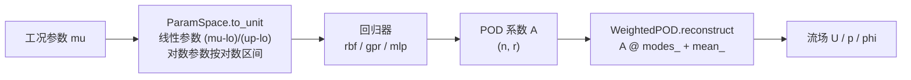

# 回归器

稳态 ROM 的最后一步：用回归器把工况参数映射到 POD 系数，再由 POD 基重建流场。回归器本身不知道网格，
也不知道场的物理含义——它只看到归一化后的参数和一列列标量系数。

- 代码：`src/fvmrom/rom/regressors.py`
- 调用方：`src/fvmrom/rom/steady.py`（`SteadyROM`）、`src/fvmrom/rom/evaluate.py`、`scripts/fit_and_eval.py`
- POD 基的算法见 `docs/pod.md`

## 在 ROM 中的位置



- 输入 `Z`：形状 `(n, d)`，每个分量落在 `[0, 1]` 的单位立方体内。单位化由 `ParamSpace.to_unit` 完成：

  $$
  z_j = \begin{cases}
  \dfrac{\mu_j - l_j}{u_j - l_j}, & \text{线性参数} \\
  \dfrac{\ln \mu_j - \ln l_j}{\ln u_j - \ln l_j}, & \text{对数参数}
  \end{cases}
  $$

  其中 $l_j$ 、 $u_j$ 是第 $j$ 个参数的下界与上界（`ParamSpace` 的 `lower`/`upper`），对数参数在 $\ln \mu_j$ 上
  线性归一化。
- 输出 `A`：形状 `(n, r)`，每个模态一列；每一列当作独立的标量目标，回归器不建模模态之间的相关性。
- `SteadyROM` 对每个场各拟合一套"POD + 回归器"（`U`、`p`、`phi` 各有自己的模态数与系数），场的形状记录在
  `shapes_` 里，`predict` 时再 reshape 回去。

## 公共接口

```python
regressor.fit(Z, A)                        # 返回 self
regressor.predict(Z, return_std=False)     # (n, r)，或 (mean, std) 二元组
```

- `Z`、`A` 都必须是二维 `float` 数组，行数一致，否则 `ValueError`。
- 未拟合时 `predict` 抛出 `RuntimeError`。
- 按名构造：`make_regressor(kind, **kw)`，大小写不敏感；`REGRESSOR_KINDS = {"rbf": RBFRegressor,
  "gpr": GPRRegressor, "mlp": MLPRegressor}`，未知名字抛 `ValueError` 并列出可选值。
- 当 `A` 没有任何列（ $r = 0$ ）时，三种回归器都构造空模型，`predict` 返回 `(n, 0)` 数组（GPR / MLP 在
  `return_std=True` 时返回两个 `(n, 0)` 数组；RBF 不支持 `return_std`）。

## `RBFRegressor`

SciPy 的径向基函数插值，一次拟合所有系数列。

| 参数 | 默认值 |
| --- | --- |
| `kernel` | `"thin_plate_spline"`（薄板样条） |
| `smoothing` | `0.0`（纯插值，严格经过样本点） |
| `degree` | `None`（交给 SciPy 决定该核的默认多项式次数） |

核函数为薄板样条：

$$
\varphi(r) = r^2 \ln r \quad (r > 0), \qquad \varphi(0) = 0
$$

`degree=None` 时 SciPy 取该核允许的最小多项式次数，对 `thin_plate_spline` 是 1，即附加一个线性多项式项。
设训练样本为 $\mathbf z_1, \dots, \mathbf z_n \in [0, 1]^d$ （单位立方体内的参数）， $A_{ik}$ 为样本 $i$ 的
第 $k$ 个 POD 系数，则第 $k$ 个系数（ $k = 1, \dots, r$ ）的插值函数为

$$
a_k(\mathbf z) = \sum_{i=1}^{n} \lambda_{ik}\,\varphi\left(\lVert \mathbf z - \mathbf z_i \rVert\right)
+ \mathbf c_k^{\mathsf T} \begin{bmatrix} 1 \\ \mathbf z \end{bmatrix}
$$

其中 $\lambda_{ik}$ 是第 $k$ 列的核权重， $\mathbf c_k \in \mathbb{R}^{d+1}$ 是线性多项式项的系数，
$\lVert \cdot \rVert$ 为欧氏距离。

权重由插值条件 $a_k(\mathbf z_i) = A_{ik}$ 与正交约束

$$
\sum_{i=1}^{n} \lambda_{ik} \begin{bmatrix} 1 \\ \mathbf z_i \end{bmatrix} = \mathbf 0
$$

共同确定，写成如下的分块线性系统：

$$
\begin{bmatrix} \Phi & P \\ P^{\mathsf T} & 0 \end{bmatrix}
\begin{bmatrix} \Lambda \\ C \end{bmatrix}
=
\begin{bmatrix} A \\ 0 \end{bmatrix},
\qquad
\Phi_{ij} = \varphi\left(\lVert \mathbf z_i - \mathbf z_j \rVert\right), \quad
P = [\mathbf 1\ \ Z]
$$

其中 $P \in \mathbb{R}^{n \times (d+1)}$ ， $Z$ 的第 $i$ 行为 $\mathbf z_i^{\mathsf T}$ ； $\Lambda_{ik} = \lambda_{ik}$ ，
$C$ 的第 $k$ 行为 $\mathbf c_k^{\mathsf T}$ 。约束 $P^{\mathsf T}\Lambda = \mathbf 0$ 使多项式部分不被核项
重复表示。 $r$ 个系数列共用同一块矩阵（只做一次分解），每列各自有右端项与权重，因此 `fit` 只需构造一个
`RBFInterpolator`。`smoothing > 0` 时 SciPy 在 $\Phi$ 的对角线上加 `smoothing`，此时不再严格经过样本点，
变为平滑近似。

样本数必须足以确定 $P$ 的 $d+1$ 个列，即至少 $d+1$ 个不在同一仿射超平面上的点，否则 $P$ 列不满秩、
SciPy 会报错；当前算例的样本数远大于该下限。

- 内部就是 `scipy.interpolate.RBFInterpolator(Z, A, kernel=..., smoothing=..., degree=...)`，存于 `model_`。
- 精确插值，不提供不确定度：`predict(..., return_std=True)` 直接抛 `ValueError`。
- 默认是精确插值（`smoothing=0`）；需要平滑时只能调 `smoothing`，没有其它正则项。

## `GPRRegressor`

每个模态（`A` 的每一列）单独拟合一个 sklearn `GaussianProcessRegressor`，共 `r` 个模型，存于 `models_`。

核函数（各向异性 Matérn， $\nu = 2.5$ ，加白噪声）：

$$
k(\mathbf{z}, \mathbf{z}') = \sigma_c^2 \left(1 + \sqrt{5}\,r + \frac{5}{3} r^2\right) e^{-\sqrt{5}\,r} + \sigma_n^2\, \delta_{\mathbf{z}\mathbf{z}'},
\qquad
r = \sqrt{\sum_{j=1}^{d} \frac{(z_j - z'_j)^2}{\ell_j^2}}
$$

其中 $\sigma_c^2$ 是 `ConstantKernel` 的常数因子（初始 `1.0`，边界 `(1e-3, 1e3)`）， $\ell_j$ 是第 $j$ 维的
`length_scale`（标量初值按输入维数复制成每维一个，即各向异性）， $\sigma_n^2$ 是 `WhiteKernel` 的噪声水平
（初始 `1e-6`）， $\delta_{\mathbf{z}\mathbf{z}'}$ 只对完全相同的两个输入取 1。构造方式（`GPRRegressor.kernel`）：

```python
ConstantKernel(1.0, (1e-3, 1e3)) * Matern(length_scale=每维一个值, length_scale_bounds=(1e-2, 1e2), nu=2.5)
  + WhiteKernel(noise_level=1e-6, noise_level_bounds=(1e-10, 1e0))
```

| 参数 | 默认值 | 说明 |
| --- | --- | --- |
| `nu` | `2.5` | Matern 平滑度（5/2 次可微） |
| `length_scale` | `1.0` | 标量时按输入维数复制成向量，即每维一个长度尺度（各向异性） |
| `length_scale_bounds` | `(1e-2, 1e2)` | 长度尺度的优化边界 |
| `noise_level` | `1e-6` | `WhiteKernel` 的初始噪声水平 |
| `noise_level_bounds` | `(1e-10, 1e0)` | 噪声水平的优化边界 |
| `alpha` | `1e-10` | 加到协方差矩阵对角线上的抖动 |
| `n_restarts` | `0` | `n_restarts_optimizer`：只从初始核参数出发优化一次 |
| `random_state` | `0` | 传给每个 `GaussianProcessRegressor` |
| `normalize_y` | `True` | 在内部对系数做零均值、单位方差处理 |

- `predict(return_std=True)` 返回 `(mean, std)`，两列都按模态拼成 `(n, r)`；`std` 是**系数空间**的预测标准差。
- 超参优化常停在长度尺度 / 噪声的边界上，sklearn 会发 `ConvergenceWarning`；`scripts/fit_and_eval.py`
  把该警告过滤掉，属预期现象。
- 计算量随样本数立方增长；样本数远大于几百时不适合。

## `MLPRegressor`

PyTorch 全连接网络，输入 `d` 个参数，输出 `r` 个系数。依赖是可选的 `nn` extra。

| 参数 | 默认值 | 说明 |
| --- | --- | --- |
| `hidden` | `64` | 隐层宽度 |
| `n_layers` | `2` | 隐层数（`SiLU` 后接 `Linear` 的次数），至少为 1 |
| `seeds` | `(0,)` | 每个种子训练一个网络；不能为空 |
| `adam_steps` | `1000` | Adam 步数 |
| `adam_lr` | `1e-2` | Adam 学习率 |
| `lbfgs_steps` | `200` | L-BFGS 的 `max_iter` |
| `weight_decay` | `0.0` | Adam 的权重衰减 |
| `device` | `"cpu"` | 训练 / 推理设备 |

网络结构：输入 $\mathbf{z}' \in \mathbb{R}^{d}$ ，隐层宽度 $H$ （`hidden`），隐层数 $L$ （`n_layers`）：

$$
\mathbf{h}^{(0)} = \mathbf{z}', \qquad
\mathbf{h}^{(l)} = \operatorname{SiLU}\left(\mathbf{W}^{(l)} \mathbf{h}^{(l-1)} + \mathbf{b}^{(l)}\right), \quad l = 1, \dots, L,
\qquad
\hat{\mathbf{a}}' = \mathbf{W}^{(L+1)} \mathbf{h}^{(L)} + \mathbf{b}^{(L+1)}
$$

$$
\operatorname{SiLU}(x) = \frac{x}{1 + e^{-x}}
$$

其中首层 $\mathbf{W}^{(1)} \in \mathbb{R}^{H \times d}$ 、中间层 $\mathbf{W}^{(l)} \in \mathbb{R}^{H \times H}$ 、输出层
$\mathbf{W}^{(L+1)} \in \mathbb{R}^{r \times H}$ 。即每层 `Linear(width, hidden) → SiLU`，最后接一个不加激活的
`Linear(hidden, r)`；全程 `float64`。

`n_layers=2`、`hidden=64` 时宽度依次为 `d → 64 → 64 → r`，对应 `_build` 里的
`Linear(d, 64) → SiLU → Linear(64, 64) → SiLU → Linear(64, r)`； $\hat{\mathbf{a}}'$ 是标准化空间中的输出。

训练流程（每个种子一次）：

1. 用训练集统计量标准化：

   $$
   z'_{ij} = \frac{z_{ij} - \bar{z}_j}{\hat{\sigma}_{z,j}}, \qquad
   a'_{ik} = \frac{a_{ik} - \bar{a}_k}{\hat{\sigma}_{a,k}}
   $$

   其中 $\bar{z}_j$ 、 $\hat{\sigma}_{z,j}$ 即 `z_mean_`、`z_std_`， $\bar{a}_k$ 、 $\hat{\sigma}_{a,k}$ 即 `a_mean_`、
   `a_std_`（训练集上按列求均值与标准差）；标准差为 0 的列替换为 1（`_safe_std`），避免除零。
2. 在 `torch.random.fork_rng(devices=[])` 里 `torch.manual_seed(seed)`，构造网络并训练——不扰动全局 RNG。
3. 损失为 MSE（`torch.nn.MSELoss`，对全部元素取平均）：

   $$
   \mathcal{L} = \frac{1}{n r} \sum_{i=1}^{n} \sum_{k=1}^{r} \left(\hat{a}'_{ik} - a'_{ik}\right)^2
   $$

   先 Adam（`adam_steps`、`adam_lr`、`weight_decay`），再 L-BFGS（`max_iter=lbfgs_steps`，
   `line_search_fn="strong_wolfe"`）。
4. 训练完 `net.eval()`，放进 `models_`。

预测：

- `predict(Z)` 用训练时保存的 `z_mean_`/`z_std_` 标准化输入，返回集成平均（ $\hat{a}'_{s,k}$ 是第 $s$ 个网络的
  输出， $\mathcal{S}$ 是种子集合）：

  $$
  \hat{a}_k = \hat{\sigma}_{a,k} \cdot \frac{1}{|\mathcal{S}|} \sum_{s \in \mathcal{S}} \hat{a}'_{s,k} + \bar{a}_k
  $$

  即反标准化 `mean * a_std_ + a_mean_`。
- `predict(Z, return_std=True)` 需要至少两个种子（即至少两个网络），否则抛 `ValueError`；`std` 是各网络
  预测的总体标准差（`np.std`，`ddof=0`）再乘 `a_std_`，同样是系数空间的量：

  $$
  \mathrm{std}_k = \hat{\sigma}_{a,k} \sqrt{\frac{1}{|\mathcal{S}|} \sum_{s \in \mathcal{S}} \left(\hat{a}'_{s,k} - \bar{a}'_k\right)^2},
  \qquad
  \bar{a}'_k = \frac{1}{|\mathcal{S}|} \sum_{s \in \mathcal{S}} \hat{a}'_{s,k}
  $$
- 未安装 PyTorch 时，构造 `MLPRegressor` 即抛 `ImportError`，提示
  `uv sync --extra rom --extra nn`（或 `uv pip install torch`）。

## 对比

| 回归器 | 方法 | 神经网络 | 不确定度 | 依赖 | 适合场景 |
| --- | --- | --- | --- | --- | --- |
| `rbf` | SciPy 薄板样条插值 | 否 | 不支持 | `scipy` | 样本少、参数维数低，追求精确插值 |
| `gpr` | 每个模态一个高斯过程 | 否 | 支持（系数标准差） | `scipy`、`scikit-learn` | 默认首选；样本少时精度最好，能给不确定度 |
| `mlp` | PyTorch 全连接网络 | 是 | 支持（多种子集成标准差） | `torch`（`--extra nn`） | 样本多、维数高时的候选；当前 30 样本下不如 GPR |

实测精度见 `README.md` 的"已验证结果"。

## 与脚本的关系

`scripts/fit_and_eval.py`：

- `--regressors rbf,gpr,mlp`（默认三种全做）逐个训练一个 `SteadyROM`，模型写到
  `data/<problem>/<study>/models/<kind>.pkl`，误差写进 `report.json`。
- `--mlp-seeds N`（默认 `5`）**只**用于 `--learning-curve` 的多种子稳定性统计：内部调用
  `learning_curve(..., mlp_seeds=tuple(range(N)))`，对每个样本量、每个种子单独训练一个单种子网络，报告
  均值与标准差。主报告的 `mlp.pkl` 仍是默认 `seeds=(0,)` 的单个网络；学习曲线的 MLP 曲线点也固定用
  种子 0，以便和其它回归器公平比较。

## 模型文件（`.pkl`）

### 格式

`.pkl` 是 Python 标准库 `pickle` 的二进制序列化格式（`pickle.HIGHEST_PROTOCOL`），**不是**神经网络
专用格式，也不是可移植的模型交换格式。`SteadyROM.save` 把整个对象打包成一个字典再 `pickle.dump`：

| 键 | 内容 |
| --- | --- |
| `version` | 格式版本，当前 `_FORMAT_VERSION = 1` |
| `versions` | 保存时的依赖版本：`numpy`、`scipy`、`sklearn`、`torch`（未安装为 `None`）、`fvmrom` |
| `space` | `ParamSpace`（参数名、上下界、对数标志） |
| `regressor` | 回归器名字符串 |
| `n_modes`、`energy_tol`、`regressor_kw` | 拟合参数 |
| `pods` | `{场名: WeightedPOD}`，含 `mean_`、`modes_`、`singular_values_` 与权重 |
| `models` | `{场名: 回归器对象}` |
| `shapes` | `{场名: 单样本展平前的形状}`，`predict` 时用来还原布局 |

`scripts/fit_and_eval.py` 为每个回归器各写一份 `models/<kind>.pkl`。同一批快照下三份文件的 POD、参数空间、
形状完全相同，差别只在 `models` 里的对象：

- `rbf.pkl`：每场一个 `scipy.interpolate.RBFInterpolator`。
- `gpr.pkl`：每场一个 `list[sklearn.gaussian_process.GaussianProcessRegressor]`，每个模态一个。
- `mlp.pkl`：每场一个 `list[torch.nn.Sequential]`，每个种子一个。

### 加载

`SteadyROM.load(path)` 先 `pickle.load`，然后：

- 反序列化用兼容 unpickler：旧模型里记录的 `fvmrom.params` / `fvmrom.problems` 会映射到
  `fvmrom.core.params` / `fvmrom.case_templates`，模块搬家（见 `docs/architecture.md`）前保存的 `.pkl`
  仍能加载。
- `version` 不等于 `_FORMAT_VERSION` 时抛 `ValueError`（`unsupported ROM format ...`），不做兼容转换。
- 比较 `versions` 与当前环境：`versions` 缺失或为空（加入 `versions` 字段之前写的模型）时跳过；否则逐项比对，不一致时
  发 `RuntimeWarning`（形如 `numpy 1.26.4 -> 2.1.0`），但**仍然继续加载**。
- 通过检查后按字典重建 `SteadyROM`，直接把 `pods`、`models`、`shapes` 赋回去。

### 注意事项

- **安全**：`pickle.load` 会执行文件里指定的任意构造逻辑，等价于执行代码。只加载本机可信文件（例如本项目
  `fit_and_eval.py` 生成的 `data/**/models/*.pkl`），不要打开别人给的 pickle。
- **依赖安装**：加载 `mlp.pkl` 需要装 torch（反序列化 `torch.nn.Sequential`）；`rbf.pkl` 需要 scipy，
  `gpr.pkl` 需要 scikit-learn。否则会在反序列化阶段报 `ModuleNotFoundError`。
- **版本绑定**：pickle 内容与库的实现绑定，不同 numpy / scipy / scikit-learn / torch 版本可能读不出来或
  行为不同。`save` 记录版本只为给出提示，不保证跨版本兼容。
- **不能跨语言**：Python pickle 无法在 C++/OpenFOAM 内使用。目前 ROM 只在 Python 侧预测，结果再写成
  OpenFOAM 时间目录；若要嵌入求解器，需要另行导出（ONNX / TorchScript 等），目前尚未实现。
