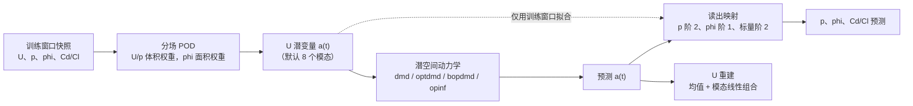

# 瞬态 ROM（阶段 2：时间外推）

阶段 2 是三阶段路线的第二步（非侵入式稳态场重建 → **瞬态时间外推** → 几何泛化）：网格和
$\mathrm{Re}$ 固定，只用前几个周期的 FOM 快照训练，之后不再调用 OpenFOAM，由潜空间动力学把解推进下去。
本文记录已实现的算例、方法、指标、结果与已知限制。

- 代码：`src/fvmrom/rom/transient.py`（`TransientROM`、`Readout`）、`src/fvmrom/rom/dynamics.py`（四种动力学）、
  `src/fvmrom/rom/evaluate_transient.py`（指标）；FOM 侧 `src/fvmrom/foam/transient.py`、
  `src/fvmrom/case_templates/cylinder_transient.py`
- 脚本：`scripts/generate_transient.py`、`scripts/shedding_report.py`、
  `scripts/fit_and_eval_transient.py`、`scripts/opinf_lambda_scan.py`
- POD 的加权与截断见 [pod.md](pod.md)；OpenFOAM 访问层见 [foam.md](foam.md)；总体设计见
  [architecture.md](architecture.md)；路线图见 [roadmap.md](roadmap.md)

## 目标与范围

- **单一算例**： $\mathrm{Re} = 100$ 的二维圆柱涡脱落。用前 3 个周期（90 个快照）训练，外推预测其后约
  14 个周期。流态是极限环上的周期解，这是"时间外推"最有利的情形。
- **方法**：标准 DMD、Optimized DMD、BOP-DMD 作基线，Operator Inference（OpInf）为主方法，全部非神经网络。
  OpInf 的二次形式契合不可压 NS 方程，是路线图里选定的主线。
- **不做**：HODMD、LSTM；潜空间神经 ODE 留作 M5，是有条件的备选（本阶段未做），是否做看 M6 的结果。先把手上
  的线性/二次方法做扎实，再判断是否需要神经动力学。
- **后续验证算例**（已写入计划，各自细化；里程碑编号只是计划里的名称，不表示顺序，当前拟定顺序为 M6 →
  视 M6 结果决定 OpInf 改进与 M5 → M7 → M8）：M6 圆柱 $\mathrm{Re} = 150\text{–}180$ 是下一步（另开计划），
  用来回答"结论对 $\mathrm{Re}$ 是否稳健"并独立检验读出阶次 / 岭参数准则，开跑前须在其计划里定好选择准则、
  验收阈值（不沿用 $\mathrm{Re}=100$ 的）与 OpInf 是否先改进；M5 仍是条件备选，排在 M6 之后（DMD 家族与
  OpInf 都不够好时才触发，当前未成立）；M7 方腔非定常启动（衰减型瞬态，检验非周期流）；M8 后向台阶（需先做
  pilot 定域与网格），视 M6、M7 结果再定。

## FOM 与数据

### 算例设置

用 `pimpleFoam`（层流）：`forceCoeffs` 需要注册的输运模型，`icoFoam` 不提供。`nOuterCorrectors 1` 即退化为
PISO。主要设置：

| 项 | 取值 |
| --- | --- |
| 时间格式 | `ddt backward` |
| 对流格式 | `div(phi,U) Gauss linearUpwind grad(U)` |
| 时间步长 | `dt = 0.005`（base 网格，最大 Courant 约 0.36） |
| 压力修正 | `nCorrectors 2`、`nNonOrthogonalCorrectors 1`、`momentumPredictor yes` |
| 压力求解 | GAMG，`tolerance 1e-9`、`relTol 0`（较严，是 FOM 偏慢的主要原因之一） |
| 边界 | 入口 `U` 固定、出口 `p = 0`、上下 `slip`、圆柱 `noSlip`、前后 `empty` |

涡脱落靠人为扰动触发：`setFields` 在尾迹盒子 $x \in [0.6, 4]$ 、 $y \in [-0.5, 0.5]$ 内把 `U` 改成
`(1 0.1 0)`，扰动幅值 0.1。

### 两段式运行与续算

一段跑到极限环、一段采样，是因为 spin-up 的场几乎用不上，却占磁盘：

- **spin-up**：在 `t_spin` 之前只在检查点写场（`writeInterval` 取 `checkpoint_dt` 的整数倍，默认 10），
  且 `purgeWrite 3` 只保留最近三个检查点。
- **生产段**：从 `t_spin` 起每 0.2 个时间单位（`snapshot_dt`）写一个快照，`writePrecision 10`、ASCII
  （`fvmrom.foam.fields` 只读 ASCII）。两段输出追加到同一个 `log.pimpleFoam`，完成判据是日志里 `End`
  出现的次数等于阶段数。

`Allrun` 可重入：若最新时间已到某阶段终点，就跳过该阶段，所以中断后重跑不会从头再来。
`run_transient(resume=True)` 在续算前逐文件比对算例字典与当前配置，不一致就拒绝（`0/U` 与
`system/controlDict` 由运行过程自己改写，不参与比对，因此只改 `--perturb` 检测不到）。
`forceCoeffs` 的 `coefficient.dat` 时间列只有 6 位有效数字，`read_forces(dt=...)` 会把时间吸附到
$k\,dt$ 上（容差 $0.1\,dt$ ）；`pilot_fine` 的 `dt = 0.2/60` 就是靠这一步才能和 6 位数字对上。

### 快照

`snapshots.npz` 的键：`times`、`U`、`p`、`phi`、`volumes`、`phi_weights`、`forces`（Cd、Cl 两列）、
`re`。生产数据为 501 个快照（ $t = 60\text{–}160$ ，间隔 0.2，约 17 个周期），文件约 639 MB，算例目录约
2.2 GB。`forces.npz` 与 `meta.json`（配置、网格规模、最大 Courant、脱落统计、数据质量指标）放在同一个
`data/cylinder_transient/<study>/` 下，与阶段 1 的数据布局一致。

生产段的数据质量：U–`phi` 一致性（FOM 自身）在单位权重下均值 1.75e-4、面积权重下 1.66e-4；`phi`
散度最大 1.0e-11；时间轴均匀到 1.7e-14。

### 域与网格 pilot

$\mathrm{Re} = 100$ 跑到 $t = 250$ 比较三组网格（`checkMesh` 均为 Mesh OK）：

| study | 域 / 分辨率 | 单元数 |
| --- | --- | --- |
| `pilot_base` | $x \in [-10, 25]$ 、 $y \in [-10, 10]$ ，`res 1` | 32768 |
| `pilot_wide` | $x \in [-15, 40]$ 、 $y \in [-20, 20]$ | 94208 |
| `pilot_fine` | base 域，`res 1.5` | 73728 |

| 量 | base | wide（偏差） | fine（偏差） | 阈值 |
| --- | --- | --- | --- | --- |
| St | 0.1682 | 0.1656（−1.57%） | 0.1692（+0.56%） | < 2% |
| 平均 Cd | 1.4262 | 1.3940（−2.25%） | 1.4093（−1.19%） | < 3% |
| Cl 幅值 | 0.3891 | 0.3794（−2.48%） | 0.3682（**−5.37%**） | < 5% |
| 极限环达到时间 | 47.6 | 48.3 | 47.3 | — |
| 最大 Courant | 0.356 | 0.355 | 0.361 | ≤ 0.6 |

fine 的 Cl 幅值超阈值，**决定沿用 base 网格**（用户确认），把 Cl 幅值约 5% 的网格敏感性记为已知限制：
FOM 的 Cl 幅值不一定是网格收敛值，且相对文献偏高；但 ROM 对比的是同一个 FOM 的快照，这个偏差不影响
ROM 的相对评估。文献参考值（St ≈ 0.16–0.17、平均 Cd ≈ 1.3–1.5、Cl 幅值约 0.3）只作合理性检查。

生产运行取 `t_spin = 60`：极限环从 47.6 开始，Cl 幅值在 $t \approx 56$ 时已与终值相差 < 0.2%。

## ROM 结构



### 训练 / 预测切分

- 周期 $T = 1/f$ ，`f` 取**整段快照 Cl 的主频**，只用于决定切分点；与只用训练窗口估计的主频相差
  0.008%，切出的 `n_train` 也不变（计划约定，影响极小，见"已知限制"）。
- 训练 = 前 3 个周期共 90 个快照（ $t \le 77.8$ ）；预测 = 其后 411 个快照，即 13.8 个周期。这比计划的
  10 个周期更长，外推难度也更大。
- **POD 基、读出映射、动力学、OpInf 的 λ 选择都只用训练窗口**。脚本层面有测试：扰动预测窗口的数据，
  训练产物不变。

### 分场 POD 与潜变量

- `U`、`p` 用单元体积权重，`phi` 用面积权重（`phi_weights`：内部面
  $(V_P + V_N)/(2\lVert\mathbf{S}_f\rVert^2)$ 、patch 面 $V_P/\lVert\mathbf{S}_f\rVert^2$ ）。阶段 1 的
  `phi` 用单位权重、只适用于均匀网格；改成面积权重是路线图里的前置事项。
- 默认 `U`、`p`、`phi` 各 8 个模态（`None` 表示交给 `energy_tol`）。
- **动力学只在 `U` 的潜空间上做**。`p`、`phi` 与标量输出（Cd、Cl）由 `U` 的潜变量经多项式读出映射
  预测；默认阶次 `p` 为 2、`phi` 为 1、标量为 2。标量用二次项的原因是 Cd 以 $2f$ 振荡，线性映射跟不上。
  读出的岭参数 1e-10 是相对单位列范数而言的。
- `phi` 的重建 = 均值 + 模态线性组合，所以和阶段 1 一样保持离散质量守恒（散度 ~1e-11）；代价是它与重建
  `U` 的通量并不严格一致（U–`phi` 一致性只报告，见下）。

### `Dynamics` 协议

```python
dynamics.fit(t, A)                 # 只给训练窗口
dynamics.predict(t, a0=None, t0=None)
dynamics.spectrum()                # DMD 家族返回频率/增长率/幅值；OpInf 返回 None
```

DMD 家族对 `a0`、`t0` 不敏感：它们对整条训练轨迹做全局拟合，`predict` 解析求值；OpInf 则是从训练窗口
末的真实状态出发做数值积分。**两类方法处理初始条件的方式不同，报告与对比时必须注明**，否则容易把
"初值不同"误读成"动力学优劣"。

## 动力学方法

### 标准 DMD

精确 DMD：对 $\mathbf{A}_1 = [\mathbf{a}_0, \dots, \mathbf{a}_{n-2}]^{\mathsf{T}}$ 做 SVD 截断，最小二乘
求伴生矩阵的特征值，再解出模态与幅值。要求 `t` 均匀。优点是快、解析、没有可调参数，适合当基线；缺点是
拟合误差在时间上均匀摊开，噪声会让阻尼率系统性偏掉。

### Optimized DMD

变量投影：把模型写成
$\mathbf{a}(t) \approx \mathrm{Re}\sum_j \mathbf{b}_j e^{\lambda_j (t - t_0)}$ ，对特征值 $\lambda_j$ 做
非线性最小二乘（幅值 $\mathbf{b}_j$ 由线性最小二乘消去），初值取标准 DMD 的谱。拟合后做共轭对称化
（成对特征值取实部均值、虚部绝对值均值），保证实数据的预测仍是实数。允许非均匀采样；对噪声造成的
阻尼偏差比标准 DMD 稳健。

### BOP-DMD

在 Optimized DMD 的基础上做 bagging：对时间点做 100 次无放回抽 80% 的子样本（默认 `seed 0`），各自做变量
投影；先按最近距离把每个试验的特征值与全数据参考解一对一匹配（最大距离超过参考 $|\lambda|$ 的 5%，或
优化未收敛的试验丢弃并计数），再对幅值做相位对齐，最后取 $\lambda$ 与 $\mathbf{B}$ 的均值与标准差。
`predict` 用均值 $\lambda$ 与均值 $\mathbf{B}$ ，是**均值模型**，不是"试验预测的均值"；`spectrum()`
额外给出 `freq_std`、`growth_std`、`amplitude_std` 与 `n_used`。固定 `seed` 时结果可复现。

### Operator Inference（主方法）

模型为

$$
\frac{\mathrm{d}\mathbf{a}}{\mathrm{d}t}
= \mathbf{c} + \mathbf{A}\mathbf{a} + \mathbf{H}\,(\mathbf{a} \otimes \mathbf{a})
$$

其中 $\mathbf{a} \otimes \mathbf{a}$ 只取上三角（`np.triu_indices` 顺序），所以 $\mathbf{H}$ 是
$r \times r(r+1)/2$ 。 $\mathbf{a}$ 是去均值的 POD 系数， $\mathbf{c}$ 吸收均值的偏移，非零不是错误。
时间导数由四阶差分给出（内部中心、两端单边，内部精度约 5e-5、两端约 3e-4），因此至少需要 5 个快照且
`t` 必须均匀。回归用列归一化的岭回归，λ 无量纲（作用在单位范数列上）。

λ 的选择与复检：

- **前向留出验证**：只用训练窗口，前 75% 的样本拟合、从留出段起点积分到窗口末尾，比较潜轨迹的相对误差；
  轨迹超过训练最大范数 5 倍或积分失败即判不稳。全部候选都不稳时取最大 λ 并给出 `RuntimeWarning`。
- **重拟合后复检**（默认开启）：用全窗口重拟合后，回放整个训练窗口、再从末尾向前积分 5 个周期；不稳就
  逐级加大 λ（重拟合 + 复检），直到稳定。动机是原始流程在 `re100` 上选出的 λ = 1e-4 重拟合后在训练窗口
  内就发散——这个动机是在预测窗口里看到发散之后才加的，但**复检本身只用训练数据**。
- `opinf_norecheck` 是保留的原始流程对照（只选 λ、不复检）。
- 发散不抛异常：失败点之后用 NaN 填充并置 `diverged` / `diverged_at`，让指标和验收如实失败。

### 振幅口径

DMD 的 `amplitude` 是空间模态单位化后的 $|b_j|$ ；OptDMD / BOP-DMD 的是时间指数单位化后的
$\lVert b_j\rVert$ ，两者相差约 $\sqrt{n_t}$ 。**跨方法不可直接比较**，只能在 OptDMD 与 BOP-DMD 之间比。

## 评估指标与验收

### 误差口径

全场相对 L2 误差（`U`、`p` 用体积权重，`phi` 用面积权重）：

$$
\varepsilon_y(\tau) = \frac{\lVert \hat{\mathbf{y}}(\tau) - \mathbf{y}(\tau) \rVert_W}
{\lVert \mathbf{y}(\tau) \rVert_W}
$$

脉动口径以训练均值为参考：

$$
\varepsilon^{\mathrm{fl}}_y(\tau)
= \frac{\lVert \hat{\mathbf{y}}(\tau) - \mathbf{y}(\tau) \rVert_W}
{\lVert \mathbf{y}(\tau) - \bar{\mathbf{y}}_{train} \rVert_W}
$$

数值约为全场口径的 10 倍。两者都如实报告，**验收用全场口径**。

### 指标

| 指标 | 说明 |
| --- | --- |
| 预测周期数 $\tau$ | $(t - t_{train\_end})/T$ ， $T$ 为 FOM 脱落周期 |
| 预测时长 | 误差首次超过阈值的时间，相对 $t_{train\_end}$ ；非有限值也算越界，只有全程不越界才是 `None`（窗口长度的下界） |
| POD 投影误差 | 同一预测窗口上把 FOM 快照投到 POD 基再重建，是 ROM 误差的下界 |
| 潜空间主频误差 | 预测潜轨迹最能量列的主频与 FOM 的 Cl 主频对比 |
| Cl 幅值、Cd 均值误差 | 与 FOM 力的相对误差 |
| Cl 相位差 | 在 $\tau = 1, 5, 10$ 处的**单周期窗口内**做最小二乘单频拟合得到的局部相位差，不是累计相位误差 |
| 能量 | 周期平均 $E_k = \mathrm{mean}\,\lVert\mathbf{a}\rVert^2$ ，比较首末周期；另加 $\max\lVert\mathbf{a}\rVert$ 与训练最大值的比作发散检查。**没有检查逐周期单调性** |
| `phi` 散度 | 最大单元散度，判据 $\max(100 \times \text{FOM}, 10^{-10})$ |
| U–`phi` 一致性 | $\lVert \phi - I(\mathbf{U})\cdot\mathbf{S}_f\rVert / \lVert I(\mathbf{U})\cdot\mathbf{S}_f\rVert$ ，只报告 |

误差曲线在每个预测快照上计算； $\tau = 1, 3, 5, 10$ 处的数值取最近快照。

### 验收项

阈值与计划第 6 节一致；`U` 误差用 $\le 10^{-2}$ ，其余为严格小于。

| 检查项 | 阈值 |
| --- | --- |
| `U` 相对 L2 误差， $\tau \le 5$ 内最大 | $\le 10^{-2}$ |
| 潜空间主频相对误差 | < 1% |
| Cl 幅值相对误差 | < 2% |
| Cd 均值相对误差 | < 2% |
| $\max\lVert\mathbf{a}\rVert / \max\lVert\mathbf{a}_{train}\rVert$ | $\le 2$ （计划为 $\tau \le 10$ 内；实现取整个预测窗口） |
| 周期平均能量漂移（首末周期，取绝对值） | < 5% |
| `phi` 最大单元散度 | $\le \max(100 \times \text{FOM}, 10^{-10})$ |
| OpInf 未发散 | 仅 OpInf 方法 |

判定逻辑：任一项为 `None` 或 NaN 一律 FAIL；唯一允许 SKIP 的是缺少网格时的 `phi` 散度，此时总判定为
`INCOMPLETE` 而不是 PASS；每个方法给出 `verdict`（`PASS` / `FAIL` / `INCOMPLETE`）。阈值从不为结果放宽。

## 结果

`re100`：训练 3 个周期，U/p/phi 各 8 个模态，默认参数，**未调参**。

| 方法 | U τ≤5 最大误差 | 频率误差 | Cl 幅值误差 | Cd 均值误差 | 能量漂移 | verdict |
| --- | --- | --- | --- | --- | --- | --- |
| POD 投影下界 | 1.96e-3 | — | — | — | — | — |
| `dmd` | 2.53e-3 | 1.1e-4 | 6.45% | 1.16% | +1.47% | FAIL（仅 Cl 幅值） |
| `optdmd` | 2.37e-3 | 1.36e-4 | 0.41% | 0.022% | +1.70% | PASS |
| `bopdmd` | 2.36e-3 | 1.41e-4 | 0.16% | 0.006% | +1.53% | PASS |
| `opinf` | **1.44e-2** | 0.36% | 0.27% | 0.48% | +0.80% | FAIL（仅 U 误差；不发散） |
| `opinf_norecheck` | NaN | n/a | NaN | NaN | NaN | FAIL（t = 103.4，τ ≈ 4.3 发散） |

补充：

- `U` 全场误差（ $\tau = 1, 3, 5, 10$ ）：`dmd` 1.5e-3 / 1.6e-3 / 1.8e-3 / 2.6e-3；`optdmd`
  1.8e-3 / 1.9e-3 / 2.1e-3 / 2.3e-3；`bopdmd` 1.8e-3 / 1.8e-3 / 2.0e-3 / 2.2e-3；`opinf`
  3.9e-3 / 9.7e-3 / 1.5e-2 / 2.7e-2。
- 脉动口径在 $\tau \le 5$ 内最大：DMD 家族约 2.3–2.4e-2，OpInf 1.4e-1。
- Cl 相位（ $\tau = 1, 5, 10$ ）：DMD 家族约 −1.2° … −1.8°（几乎不漂移）；OpInf +1.8° / +8.7° / +15.8°，
  相位漂移明显，是它 `U` 误差的主要来源之一。
- `p` 误差在 DMD 家族 $\tau \le 5$ 内最大约 1.25e-1（`dmd`）：读出阶 2 放大了潜变量偏差（`p` 不在验收项）。
- `phi` 误差与同一方法的 `U` 误差同量级：DMD 家族约 2.5e-3，OpInf 1.4e-2；散度判据都通过。
- BOP 基频 0.168225 ± 1.2e-5，增长率 (1.08 ± 0.76)e-4；FOM 基频 0.1681。

### 标量读出阶 1 诊断（不参与验收）

把标量读出从默认阶 2 换成阶 1、其余不变：

| 方法 | Cl 幅值误差（阶 2 / 阶 1） | Cd 均值误差（阶 1） |
| --- | --- | --- |
| `dmd` | 6.45% / 0.52% | 3e-6 |
| `optdmd` | 0.41% / 0.54% | 2e-6 |
| `bopdmd` | 0.16% / 0.47% | 2e-6 |
| `opinf` | 0.27% / 0.53% | 7e-5 |

结论：标准 DMD 的 Cl FAIL 主要来自二次读出放大了潜变量的小偏差，不是 DMD 动力学本身——读出映射作用在
**真实**潜变量上时，测过的配置下 Cl 幅值误差都 ≤ 2.5e-3。因此"Optimized/BOP-DMD 修复了 Cl 幅值"的说法
只在阶 2 读出下成立。

### 20 周期长时外推（超出数据，只看潜空间）

训练窗口之后 20 个周期：DMD 家族与 `opinf` 全部稳定（ $\lVert\mathbf{a}\rVert$ 比 0.99–1.03，能量变化
0.25%–2.6%，潜频误差 ≤ 2.1e-3）；`opinf_norecheck` 发散。这一段没有 FOM 参考，只能说明动力学本身不炸，
不能说明精度。

### 扫描（默认参数，只报告、不设阈值）

Cl 幅值误差（U 模态数 4/6/8/10/12）：

| 方法 | 4 | 6 | 8 | 10 | 12 |
| --- | --- | --- | --- | --- | --- |
| `dmd` | 1.2% | 3.1% | 6.5% | 270% | 36% |
| `optdmd` | 0.41% | 1.6% | 0.41% | 10.8% | 9.2% |
| `bopdmd` | 0.39% | 1.6% | 0.16% | 12.9% | 18.9% |

Cl 幅值误差（训练周期 2/3/4/5）：

| 方法 | 2 | 3 | 4 | 5 |
| --- | --- | --- | --- | --- |
| `dmd` | 12.2% | 6.5% | 1.0% | 1.4% |
| `optdmd` | 1.3% | 0.41% | 2.0% | 0.89% |
| `bopdmd` | 1.4% | 0.16% | 2.0% | 0.90% |

- $\tau \le 5$ 内最大 `U` 误差：DMD 家族在 6–12 模态下约 2–4e-3，4 模态约 1.0e-2；OpInf 在
  4/6/8/10/12 模态下为 1.09e-2 / 4.9e-3 / 1.44e-2 / 3.0e-2 / 1.5e-1（12 模态发散），训练周期
  2/3/4/5 时为 1.30e-2 / 1.44e-2 / 9.9e-3 / 4.1e-2（5 周期发散）。
- 大模态数下 Cl 误差大的原因：阶 2 读出在 10、12 模态时有 66、91 个特征，而训练只有 90 个快照，接近欠定。

### OpInf 的 λ 敏感性（`scripts/opinf_lambda_scan.py`，只读诊断）

λ 取 1e-5 … 1e-2 共 13 个（`logspace(-5, -2, 13)`）：

- λ ≤ 1.78e-4：复检判不稳（预测窗口 t = 82–107 发散）。
- 3.16e-4：复检判稳，但在 t = 146 发散。
- λ ≥ 5.6e-4：不发散。
- 事后 U 误差（ $\tau \le 5$ 内最大）最小 1.24e-2（3.16e-4，后来发散）；不发散的里最小 1.41e-2；正式值
  1e-3 为 1.44e-2，更大 λ 单调变差。**13 个 λ 里没有一个低于 1e-2**；稳定 λ 下训练回放误差最小也有
  3.8e-2。

结论：问题不在 λ 网格粗，而在二次模型于可稳定的 λ 下拟合训练轨迹不够好。预测窗口指标是事后诊断，
**不用来选 λ**。

## 已知限制

**验收结论的适用范围**

- 只限定于默认配置（8 个 U 模态、3 个训练周期）。U = 10、12 时 OptDMD/BOP 的 Cl 幅值误差约 9–19%；
  训练 4 个周期时为 1.97%–1.99%，贴着 2% 的限值，说明结论对配置敏感。

**OpInf**

- `U` 误差验收 FAIL；对模态数和训练窗口敏感（12 模态、5 周期都发散）。
- λ 选择的留出段只有约 0.7 个周期，无法评估长期稳定性；复检的前向积分只有 5 个周期。
- 合成 Hopf 数据上，若训练窗口落在增长段，OpInf 回退到最大 λ 仍发散。
- 改进方向（离散形式、约束、更长留出段、多步打靶）留给后续计划，本轮不做。

**标量读出与 FOM**

- 阶 2 标量读出在快照数较少时接近欠定；读出阶次与岭参数的选择准则留到 M6 计划里定。
- FOM 的 Cl 幅值有约 5% 的网格敏感性（见 pilot），且相对文献偏高。

**指标口径**

- 能量判据只比较首末周期，没有检查逐周期单调性；Cl 相位是单周期窗口内的局部相位差。
- `report.json` 里 `fom.shedding.limit_cycle_time = 60.0` 是快照段起点的截断假象；全程值 47.6 在
  `fom.meta_shedding`。
- 训练窗口切分用了整段记录的 Cl 主频（计划约定，影响极小）。
- 预测窗口 13.8 个周期，比计划的 10 个周期更长。

**测试与脚本**

- 合成数据为让 DMD 精确用了整周期窗口；OpInf 的单元测试用无噪声精确二次系统，没有覆盖真实数据上的
  拟合困难；一个脚本测试里 `p` 模态降到 2（合成网格只有两个单元）；脚本层面的泄露测试里"Cl 只改变幅值、
  整段主频不变"的注释不严格，靠 `n_train` 相等的断言兜底。
- 审查提出、本轮未改的小问题：`run_transient` 没调用 `_check_case_path`；`_verify_case` 对 `--perturb`
  改为 0 不检测；`_snapshot_forces` 复用已有的 `forces.npz`；`Allrun` 只检查日志里有没有 `Failed`，
  不确认 `Mesh OK.`；`BOPDMD.predict` 是均值模型；`shedding_summary` 的直径、来流速度默认值未记入
  `meta`；`steady.py` 的旧路径映射未包含 `fvmrom.config`；`generate_transient.py` 导入了私有名
  `fvmrom.foam.fields._TIME_RE`。
- `--purge-fields` 会删除 spin-up 检查点与中间快照（只保留 `0`、`t_spin` 与最后一个时间），清理之后
  不能再 `--collect-only`，必须先收集一次再清理。
- `report.json` 的 `sweeps` 是"扫描类型 → 方法 → 行"，多次运行会按方法合并；`--write-fields` 写出的
  ROM 算例里 `phi` 的边界值是 ROM 预测值。
- `pilot_base` 当时 `forces.npz` 没写出的原因没查清（外层脚本被服务重启杀掉，之后用 `--resume` 补写）。
- 被 `Jobs.stop` 杀掉的作业也会记录退出码 0（实测，原因未深究），所以退出码不能单独判断成败；
  `run_transient` 靠日志里 `End` 的次数兜底。

## 使用

| 脚本 | 用途 | 主要选项 |
| --- | --- | --- |
| `scripts/generate_transient.py` | 运行 FOM 并收集快照 | `--pilot`、`--resume`、`--collect-only`、`--purge-fields`、`--checkpoint-dt`、`--workers`、`--geometry`、`--dt` |
| `scripts/shedding_report.py` | 对比 pilot 的脱落统计 | `--studies pilot_base,pilot_wide,pilot_fine` |
| `scripts/fit_and_eval_transient.py` | 训练与评估，写 `report.json` 与 `models/*.pkl` | `--methods`、`--train-periods`、`--n-modes`、`--sweep-modes`、`--sweep-train-periods`、`--write-fields N`、`--long-periods`、`--no-diagnostics` |
| `scripts/opinf_lambda_scan.py` | OpInf 的 λ 敏感性诊断（只读） | `--study`、`--ridge-grid`、`--check-periods` |

详细参数以各自 `--help` 为准。`re100` 的典型命令：

```powershell
# 1) 跑 FOM（约 2.2 GB 算例目录），收集快照后可清理中间场
uv run python scripts/generate_transient.py --study re100 --t-spin 60 --t-end 160
uv run python scripts/generate_transient.py --study re100 --t-spin 60 --t-end 160 --collect-only --purge-fields

# 2) 训练、评估并扫描
uv run python scripts/fit_and_eval_transient.py --study re100 `
    --methods dmd,optdmd,bopdmd,opinf,opinf_norecheck --train-periods 3 `
    --sweep-modes 4,6,8,10,12 --sweep-train-periods 2,3,4,5
```

`--write-fields N` 需要 FOM 算例仍在磁盘上：它把每 N 个预测快照写成
`cases/cylinder_transient_<study>_rom_<method>/run_0000/<time>/`，便于在 ParaView 里对比。
